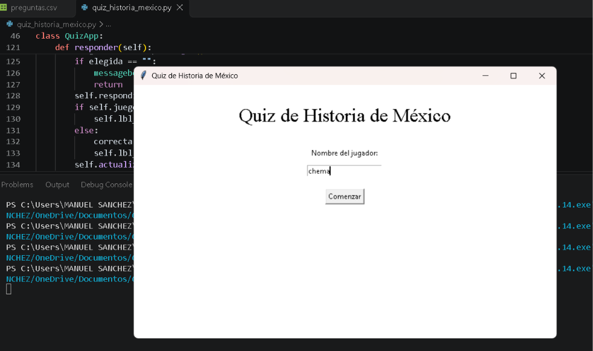
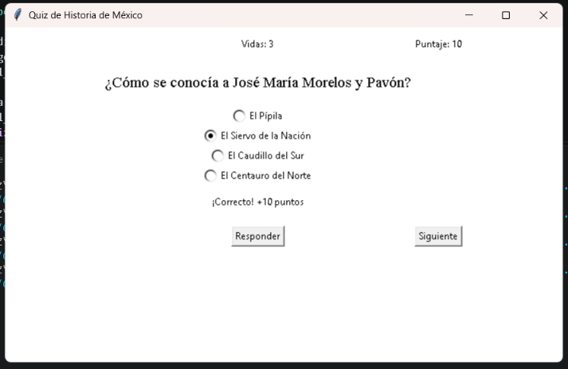

# Quiz de Historia de México

## Descripción
Juego de preguntas de opción múltiple sobre la **Independencia** y la **Revolución Mexicana**, desarrollado en Python con la librería Tkinter.
El jugador escribe su nombre y responde 5 preguntas elegidas al azar a partir de un archivo CSV. Empieza con 3 vidas: cada respuesta correcta suma 10 puntos y cada error resta una vida. El juego termina al contestar todas las preguntas o al quedarse sin vidas, y entonces se muestra una pantalla de resultados con el puntaje final.

## Captura de pantalla




https://github.com/chemasanchez06052007-web/Quiz-Historia-de-Mexico/blob/20a6a8b5b23b5ee90460dadf98d8d4d65174041a/correcto.png
## Instrucciones para ejecutar el programa

### Requisitos
- Python 3 instalado (https://www.python.org/downloads/). Tkinter viene incluido con la instalación normal.

### Pasos
1. Descarga o clona este repositorio.
2. Asegúrate de que `quiz_historia_mexico.py` y `preguntas.csv` estén **en la misma carpeta**.
3. Abre una terminal en esa carpeta y ejecuta:

```
python quiz_historia_mexico.py
```

En Windows, si el comando anterior no funciona, usa `py quiz_historia_mexico.py`.

## Archivos del proyecto
| Archivo | Descripción |
|---|---|
| `quiz_historia_mexico.py` | Código fuente del juego |
| `preguntas.csv` | Archivo de datos con las preguntas |

## Formato de preguntas.csv
Una pregunta por línea, con 6 columnas separadas por comas:

```
pregunta,opcion1,opcion2,opcion3,opcion4,correcta
```

La columna `correcta` debe ser idéntica a una de las 4 opciones. Se necesitan al menos 5 preguntas válidas para poder jugar.
